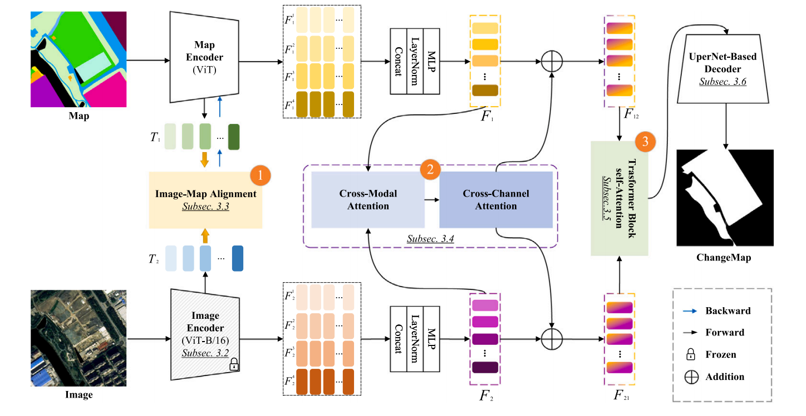
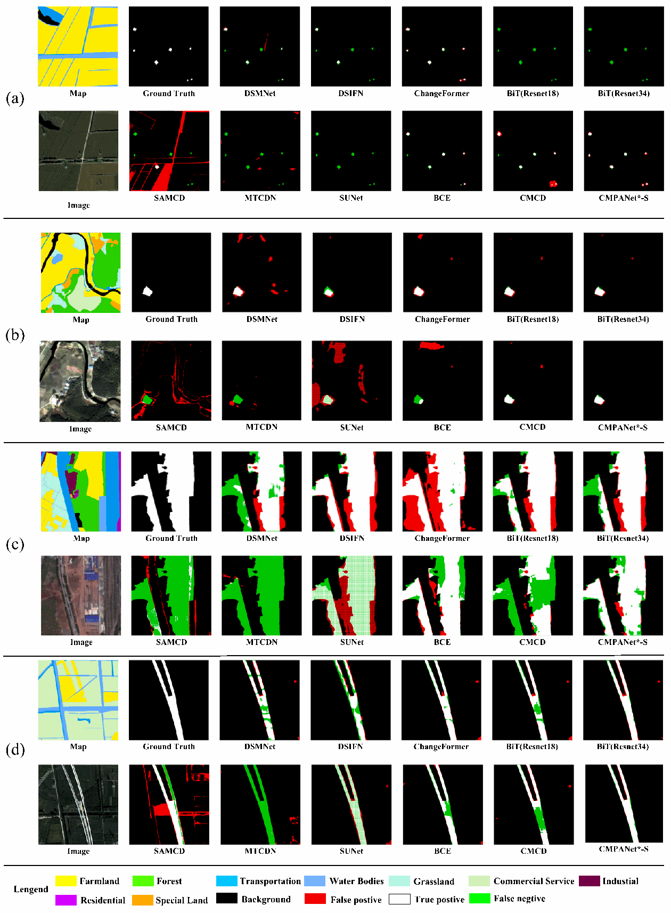
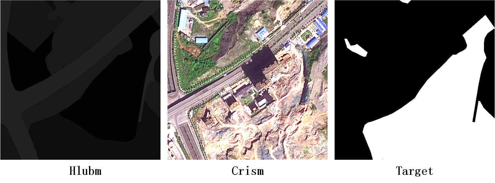

# MAP-Image Change Detection
**Cross-modal change detection using historical land use maps and current remote sensing images**

ISPRS Journal of Photogrammetry and Remote Sensing, 218 (2024), 114–132.

[Paper](https://doi.org/10.1016/j.isprsjprs.2024.10.010) · [Dataset](#dataset) · [Model downloads](#model-downloads) · [Training](#training) · [Evaluation](#evaluation) · [中文说明](docs/README_zh.md)

CMPANet detects changes between historical land-use maps and current optical imagery. This repository provides the EVLab-CMCD dataset description, a cleaned single-GPU PyTorch implementation, training/evaluation scripts, and the evaluation protocol for the released `cmpanet_small_head_24` checkpoint.

The released configuration uses a **ViT-S/16 map encoder**, a **frozen ViT-B/16 image encoder**, CCMAT with **24 attention heads**, TBAM fusion, and a UperHead decoder. The four feature chunks **share the same learned `norm1`** before pyramid construction. Training and evaluation use this same normalization.



*Architecture from Figure 2 of the paper; this is a paper illustration, not a new experimental result.*

## Released checkpoint
The root-level `cmpanet_small_head_24_max_performance.pth` was evaluated with the public `test.py` on **all 397 validation pairs**, at 512 × 512, FP32, batch size 1, no test-time augmentation, and shared `norm1`.

| Evaluation | Precision (%) | Recall (%) | F1 (%) | Change IoU (%) | OA (%) |
|---|---:|---:|---:|---:|---:|
| Released `cmpanet_small_head_24`, this code | **85.22** | **78.47** | **81.70** | **69.07** | **99.12** |
| Paper CMPANet*-S, Table 2 | 82.6 ± 1.65 | 80.5 ± 0.13 | 81.6 ± 0.15 | 69.0 ± 0.46 | 99.1 ± 0.03 |
| Paper CMPANet*-B, Table 2 | 85.3 ± 0.37 | 78.3 ± 0.61 | 81.6 ± 0.16 | 69.0 ± 0.24 | 99.1 ± 0.03 |

The checkpoint has the **Small map encoder**, even though its precision/recall resemble the paper's Base row. Its F1 differs from the reported 81.6% by +0.1025 percentage points. Single-checkpoint and paper aggregate results are distinct measurements.

**Verification scope:** the complete historical forward source has not been recovered. The compatibility implementation uses surviving source and trained normalization tensors; all decoder tensors and the teacher backbone load strictly. The public evaluator reproduces the independently audited confusion matrix exactly. This verifies the checkpoint under the documented implementation, not fresh-training reproduction of the historical run. The checkpoint was selected using evaluation performance, so this is not an untouched holdout evaluation. See [verification details](docs/VERIFICATION.md).



*Figure 9: comparison on EVLab-CMCD from the published paper. These are original paper results, not predictions newly generated by this release.*

## Installation

Tested on Windows with Python 3.10, PyTorch 2.3.1 + CUDA 11.8, torchvision 0.18.1, and RTX 4090. Bash wrappers are supplied for Linux; Linux execution has not been independently verified.

```bash
git clone https://github.com/whudk/EVLab-CMCD.git
cd EVLab-CMCD
conda create -n cmpanet python=3.10 -y
conda activate cmpanet
python -m pip install torch==2.3.1 torchvision==0.18.1 --index-url https://download.pytorch.org/whl/cu118
python -m pip install -r requirements.txt
```

Single CUDA GPU only. The default CUDA allocator limit is 60% of device memory (`--memory-fraction`); this does not guarantee a particular batch fits. Evaluation uses FP32; training defaults to AMP. Load only trusted `.pth` files.

## Dataset

**EVLab-CMCD (EVLab-SHPCD in earlier materials)** is a benchmark proposed and led by **Prof. Xiangyun Hu**, and constructed by **Dr. Kai Deng** and other members of the **Earth Vision Laboratory (EVLab), Wuhan University**.

| Split | Pairs | Image size | Resolution |
|---|---:|---|---|
| Training | 5,225 | 512 × 512 | 0.8 m |
| Validation / paper test split | 397 | 512 × 512 | 0.8 m |

Each sample contains **Hlubm** (historical map, grayscale land-use codes 0–85), **Crism** (current optical image), and **Target** (binary change label: 0 unchanged, 255 changed).



Dataset download: [Baidu Netdisk](https://pan.baidu.com/s/1Bq_P7wr5z6d3UixCyTtPtA), extraction code **`cmcd`**. Existing dataset terms remain **academic research only; commercial use is prohibited**.

`trans.xml` and `dlbm.xml` describe land-use categories and the Third National Land Use Survey classification. They are metadata: **do not use these files to remap the binary change labels**. The released config leaves `config.transxml` empty.

### Prepare manifests

Create `data/train.txt` and `data/val.txt`. Each line contains **map, image, label**, separated by whitespace:

```text
/dataset/Hlubm/0001.png /dataset/Crism/0001.png /dataset/Target/0001.png
/dataset/Hlubm/0002.png /dataset/Crism/0002.png /dataset/Target/0002.png
```

Use absolute paths or paths relative to the command's working directory (normally the repository root). Individual sample paths must not contain whitespace. Windows paths such as `D:/dataset/...` work. Use UTF-8 without BOM or blank lines. Keep the official split, rather than resplitting the validation set.

Images and labels must be aligned. Maps are read as three BGR channels by OpenCV (grayscale is replicated); images stay BGR. Map values are divided by 255; image BGR mean/std are in the config. Do not substitute RGB/ImageNet normalization.

**Evaluation mask:** nonzero source labels, including 255, become change class 1. Pixels whose map channels are all 0, or whose image channels are all 0 or all 1, are ignored. On the verified split: **99,373,806 valid + 4,697,362 ignored = 104,071,168 total pixels**. Metrics aggregate valid pixels globally. Change IoU is the change-class IoU; mIoU averages both classes.

## Model downloads

<!-- MODEL_DOWNLOADS: keep filenames, download links and hashes in sync. -->

| File | Role | Baidu Netdisk link | Extraction code |
|---|---|---|---|
| `ssl_vit_base_epoch8.pth` | Frozen image encoder; iBOT backbone + head | [Download](https://pan.baidu.com/s/1gDLdIU99Lr66i11rXh1pEw) | `cmcd` |
| `cmpanet_small_head_24_max_performance.pth` | Trained change detector / map encoder | [Download](https://pan.baidu.com/s/15o1z2YPFryg5aEJ_Chi6NA) | `cmcd` |

Weights and data are excluded from Git. Download both the trained change-detection checkpoint and the pretrained image encoder using the links above (extraction code: `cmcd` for both). Both files are needed for evaluation. The verified teacher is epoch8; the paper describes 10 pretraining epochs. Other teacher checkpoints are not interchangeable for reproducing the score.

## Evaluation

Run from the repository root (the same command works in Bash and PowerShell):

```bash
python test.py --checkpoint checkpoints/cmpanet_small_head_24_max_performance.pth --pretrained pretrained/ssl_vit_base_epoch8.pth --valtxt data/val.txt --output outputs/small24 --expect-samples 397
```


## Training

```bash
python train.py --suptxt data/train.txt --valtxt data/val.txt --pretrained pretrained/ssl_vit_base_epoch8.pth --epochs 100 --train_batch_size 4 --base_lr 0.00001 --test_interval 500 --checkpoints_name cmpanet_small_head24 --log_file logs/cmpanet_small_head24
```

Map parameters are initialized randomly unless `--resume` supplies decoder weights. `--resume` is **weight initialization / fine-tuning**, not restoration of optimizer, AMP, RNG or learning-rate progress. Legacy release weights use the same strict compatibility adapter as evaluation.


## Validation and layout

```bash
python -m unittest discover -s tests -v
python tools/smoke_test.py --pretrained pretrained/ssl_vit_base_epoch8.pth --fp16 false --steps 3
```

The smoke test uses temporary synthetic inputs and checks actual optimization, finite loss, teacher freezing, evaluation and serialization. It is not a dataset training experiment. The public evaluator was separately checked on all 397 real samples; see [recorded metrics](docs/release_metrics.json).


## Citation and attribution

```bibtex
@article{DENG2024114,
  title   = {Cross-modal change detection using historical land use maps and current remote sensing images},
  journal = {ISPRS Journal of Photogrammetry and Remote Sensing},
  volume  = {218},
  pages   = {114--132},
  year    = {2024},
  doi     = {10.1016/j.isprsjprs.2024.10.010}
}
```

Code retains original MIT/Apache notices: [LICENSE](LICENSE), [LICENSES](LICENSES), [third-party notices](THIRD_PARTY_NOTICES.md). Dataset research-use terms are separate. Paper figures retain original publication rights; see [figure sources](images/FIGURES.md).
